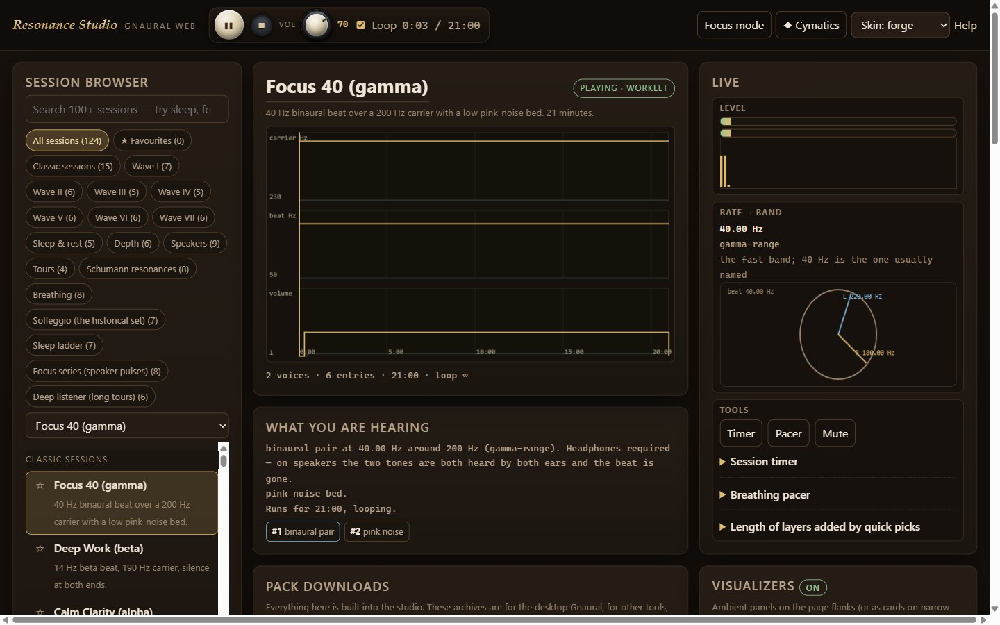
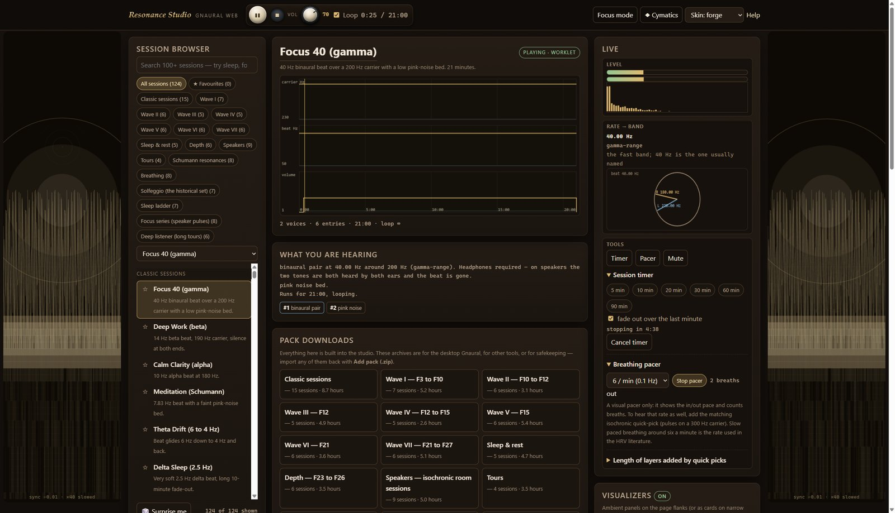
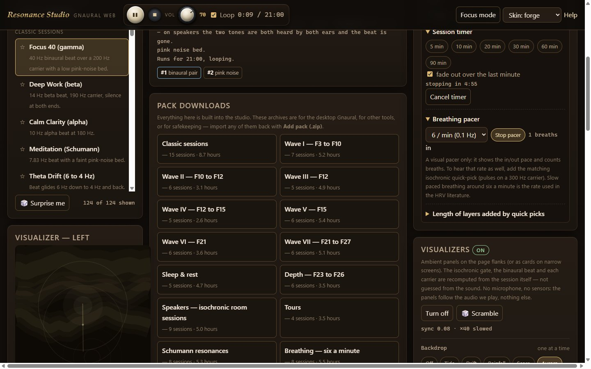
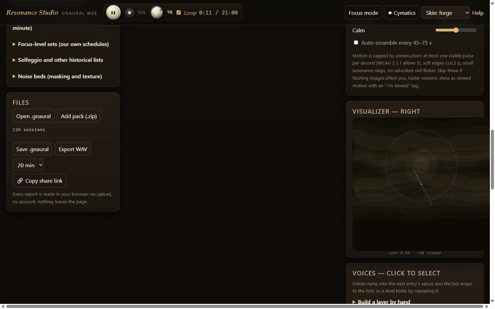
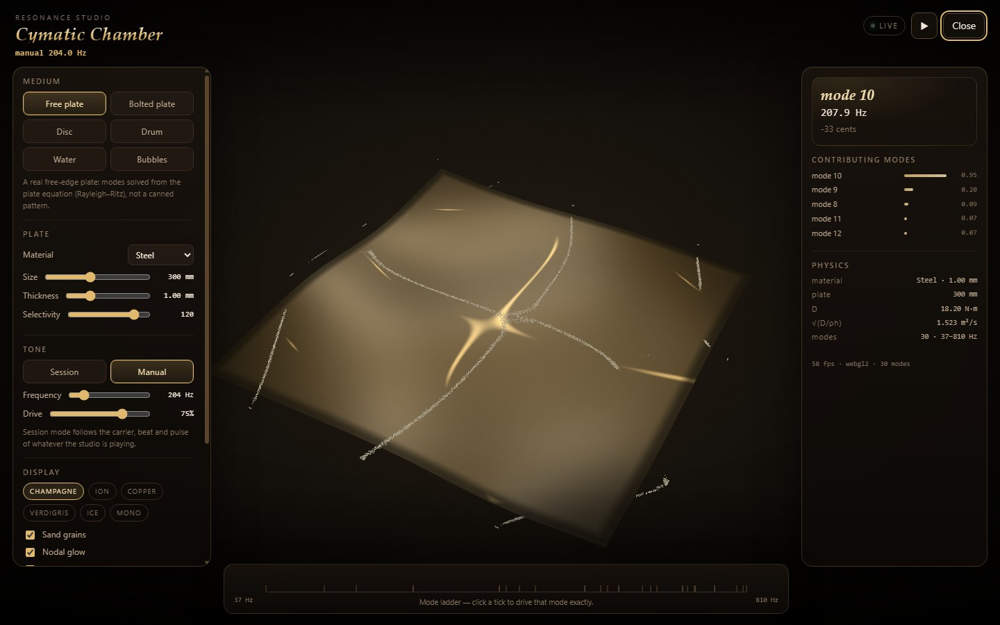

# Resonance Studio — a tone, beat and noise studio (Gnaural Web)

Binaural beats, monaural beats, isochronic pulses and noise beds, with **124 ready sessions in
18 packs** and a real schedule editor — a browser re-implementation of Gnaural's scheduling engine
and `.gnaural` format, written for moddys.net. This repository holds the Windows desktop build
and its corresponding source.

**Designed, built and maintained by Modtech** (a.k.a. **Moddy**).

- Live app: **https://moddys.net/resonance/** (free, in the browser — runs entirely in the page)
- Windows app: **the 1.0b beta** — download the installer from
  [moddys.net/moddys-downloads.html](https://moddys.net/moddys-downloads.html) or
  [Releases](https://github.com/ModdySwag/ResonanceStudio/releases); each build ships with its
  corresponding source.
- GitHub: **https://github.com/ModdySwag**
- Correspondence: **modtech@gmail.com**
- Gnaural Web port: **GPL-2.0-or-later**, with the engine (`engine.js`) under **LGPL-2.1-or-later**
  (see `COPYING` and `COPYING.LESSER`). Gnaural is © Bret Logan and contributors; this port is an
  independent re-implementation and is not affiliated with the upstream project.

Nothing here is uploaded or tracked: every export, save and share link is made locally. The
network is only touched when you follow a link.

## Screenshots

The Windows build, captured from the app itself:

## The Cymatic Chamber

A dedicated instrument behind the ambient visualizer panels. It takes the session's own carrier and
beat, solves the vibration modes of a real plate, and draws the figure that tone actually drives —
sand collects on the nodal lines. Six media, each solved rather than painted: a free steel plate
(Rayleigh–Ritz, Leissa's frequencies), the classical centre-bolted plate, a clamped disc (Bessel
modes), a circular drum, Faraday waves on water (the true gravity–capillary wavelength at half the
drive), and bubble acoustics (Minnaert resonance and Bjerknes forces). The mode ladder drives any
mode exactly; the readout gives the nearest mode and the detuning in cents.

## What it does

- **The tone made visible.** The Cymatic Chamber solves a real plate's modes and shows the figure
  the tone drives — with a mode ladder, a detuning readout and the physics numbers behind it.
- **Six voice types.** Binaural pairs (two tones, one per ear), monaural beats (two tones in both
  ears, beating in the room), isochronic pulses (one carrier switched on and off —
  speaker-friendly), and pink, brown and white noise beds. Stack any of them.
- **Ramps, not switches.** Every value — volume, carrier, rate — glides into the next entry's
  value, and the last entry wraps to the first. Sessions can be minutes or hours; a rate can slide
  from 4 to 12 Hz over an hour, a bed can fade in under a voice.
- **Library: 124 sessions, 18 packs.** Classic sessions, seven waves of focus layouts, sleep and
  nap sets, extended tours, deeper focus levels, a headphone-free speaker pack, and sets built
  from published physiological numbers — all original, all editable. Every pack is also
  downloadable as a `.zip` for the desktop Gnaural or any other tool.
- **Playback built for long listening.** A session timer that stops cleanly (optional one-minute
  fade), looping, master volume, a stop-and-mute panic button, and a breathing pacer for slow
  paced breathing at six a minute.
- **Reader and writer.** Opens `.gnaural` files from the desktop Gnaural, writes them back out,
  imports whole packs from `.zip`, and renders any schedule to a **WAV file** — all without
  leaving the page (or the app).
- **Visualizers.** A phase-exact visualizer system for the page flanks (or inline cards on narrow
  windows): choose a backdrop and overlays; the isochronic gate, the binaural beat and each
  carrier are recomputed from the session itself, not guessed from the sound. Luminance is capped
  for motion safety, and the panel respects `prefers-reduced-motion` — and the master switch
  persists.
- **Share links carry whole sessions.** A schedule you built can be copied as a link that
  contains the session itself — no server, no account. In the Windows build the link points at
  moddys.net, so it opens for anyone.

## Windows build (this repository)

The desktop app is the same code as the site — frozen, byte for byte — wrapped in a small Electron
shell that serves the bundle over a loopback origin (the same secure-origin context the app was
verified in) and adds native downloads, a manual/packs window, and a window that remembers where
it was placed.

- `site/` — the web application source: `app/` (the studio: engine, scheduler, packs, visualizers,
  tests), `help/` (manual + evidence pages), `packs/`, `credits/`, the landing page and `site.css`
- `windows/` — the packaging project: the Electron shell (`app/`), the Inno Setup script
  (`installer/`), the build chain (`tools/`), the desktop suite (`verify/`) and `version.json`
  (the frozen-tree pin the build verifies before packaging)
- `product/README-SOURCE.txt` — the hash ledger for the release artifacts
- `screenshots/` — the images above, from the installed build

Run it from source (any modern browser, no build step): open `site/app/index.html` — note the
app expects to be served (a file:// origin has no AudioWorklet in some browsers), e.g.
`python -m http.server` inside `site/`. The test suites run with plain node: `node site/app/engine.test.js`
and friends (nine files, 1,076 checks).

## Built for the whole field, not one corner of it

Measured numbers keep their provenance: the Schumann resonances are electromagnetic standing
waves in the Earth–ionosphere cavity, offered as a representation; the EEG band names and the
six-breaths-a-minute rate are ordinary practice from the literature; the solfeggio set and
A = 432 Hz are presented as 1990s tradition with no medical claim; the focus-level tone layouts
are built from publicly documented frequency sets and shipped without any affiliation. The
evidence page in the app carries the status of every claim, and says plainly what is established
(a periodic tone produces a phase-locked neural response while it plays) and what is not (that
listening to a rate durably changes your brain state).

**Not a medical device or treatment.** Keep levels audible but conversational; do not use where
you must hear your surroundings; if you have epilepsy or a seizure disorder, ask a clinician
before using repetitive pulsed tones. Full safety notes are in the manual.

## Licence

The application is free software: **GPL-2.0-or-later** (see `COPYING`); the engine is
**LGPL-2.1-or-later** (see `COPYING.LESSER`). Attribution and provenance are in `NOTICE.txt`.
Each release ships with its corresponding source.
