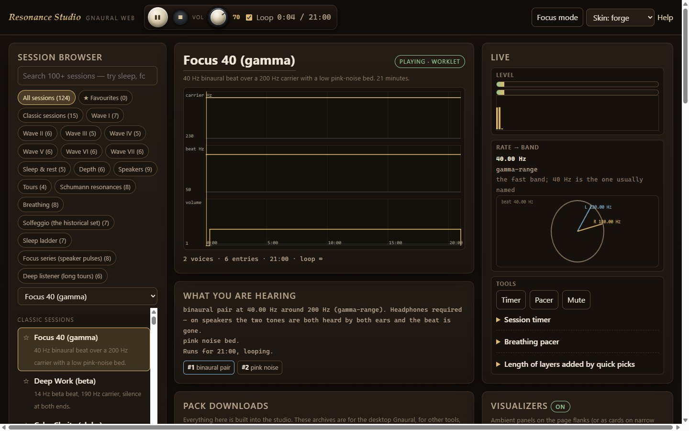
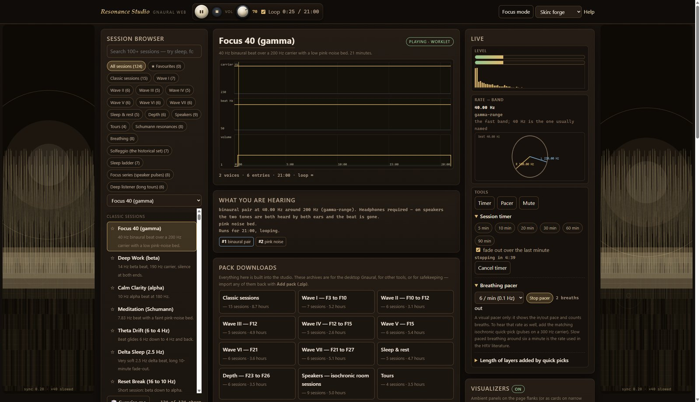
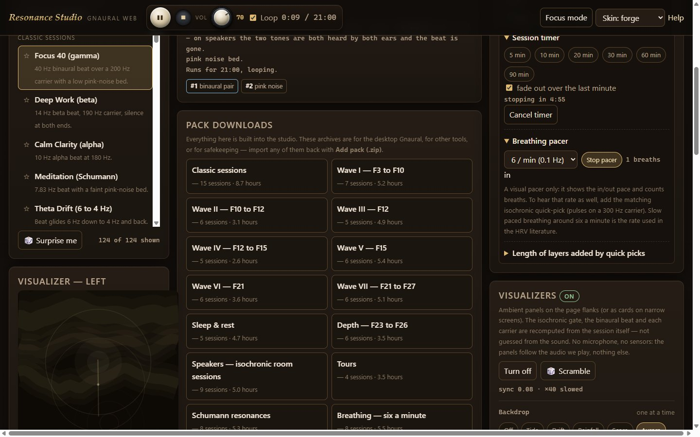
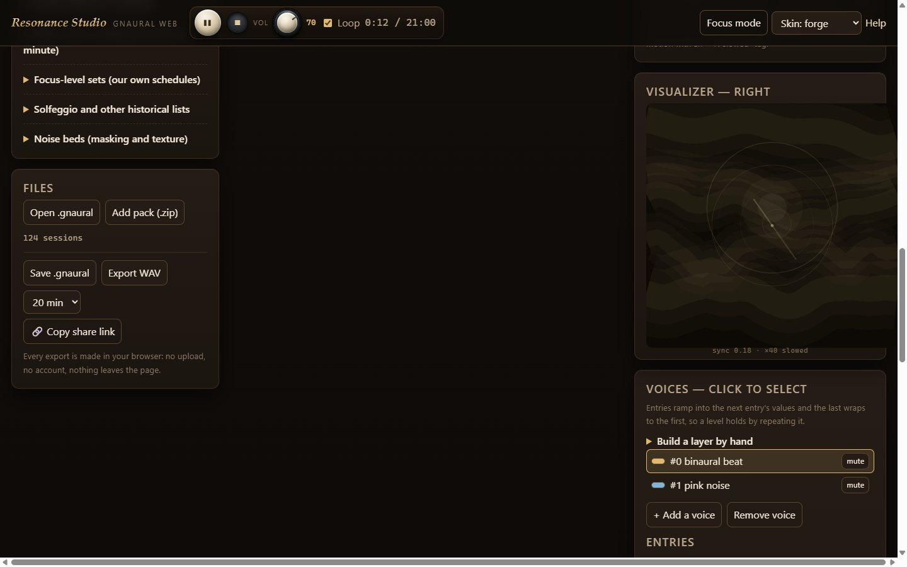

# Resonance Studio 1.0a (beta) — for Windows

The first beta of Resonance Studio for Windows.

Resonance Studio is a tone, beat and noise studio for long listening: binaural pairs, monaural
beats, isochronic pulses and pink / brown / white noise beds, with 124 ready sessions in 18 packs,
a real schedule editor with a graph you can scrub, live meters, a phase wheel and a phase-exact
visualizer system. It is the same studio as the free in-browser version at moddys.net/resonance —
this is that app in its own window, by itself, with the manual and every pack inside the install.

A look at the Windows build:

## In this release

- ResonanceStudio-Setup-1.0a.exe — the installer. Per-user (no admin prompt), a Start Menu entry
  and desktop shortcut, upgrades install straight over the top, clean uninstall from Add/Remove.
  It is not code-signed yet, so SmartScreen will say it hasn't seen this app before — More info,
  then Run anyway.
- ResonanceStudio-Setup-1.0a.exe.zip — the same installer as a zip, byte for byte: the exact file
  moddys.net/moddys-downloads.html serves.
- ResonanceStudio-1.0a-source.zip — the corresponding source for this build (GPL-2.0-or-later;
  engine LGPL-2.1-or-later): the web app source frozen into the installer, the Electron shell,
  the Inno Setup script, the build and verification tools, and the licence/attribution files.

## Good to know

- Windows 10/11, 64-bit. Everything the app needs to open is in the install — the engine, the
  worklet, the manual, all 18 pack archives — so it starts, plays and exports with no network at
  all. Nothing is uploaded and nothing is tracked.
- Your favourites, imported packs and window layout live in %APPDATA%\ResonanceStudio. The
  installer never touches that folder and the uninstaller keeps it by default — installing again
  picks up where you left off.
- Headphones for the binaural sessions; any speaker for isochronic pulses and noise beds. Keep
  the level audible but conversational. Not a medical device; see the manual's safety notes.
- Verified on this exact payload: the 57-check desktop suite on the installed program (loopback
  origin, worklet engine, real downloads, pack import, .gnaural round trip, offline boot, clean
  relaunch), the app's own 1,076 node checks, and a silent install -> upgrade -> uninstall journey
  that re-hashes every shipped file and leaves your data intact. The web app inside the installer
  is byte-identical to the one live at moddys.net/resonance.
- This is a first beta — if something breaks, tell me: modtech@gmail.com.

## sha256

  93310403af600c95f15dcc7a6219d64be2c32b0ee304250a91daa78322430faa  ResonanceStudio-Setup-1.0a.exe
  66e11a71257ea7cabe0ac7789aa14da8b6de485af560fd803f879913afd8c591  ResonanceStudio-Setup-1.0a.exe.zip
  61b7704ed68a9f9c5389eb6ee8afb33ec6c57b060583f6737497cef074acb7cb  ResonanceStudio-1.0a-source.zip

The download page is also https://moddys.net/moddys-downloads.html.

Cheers Moddy !
